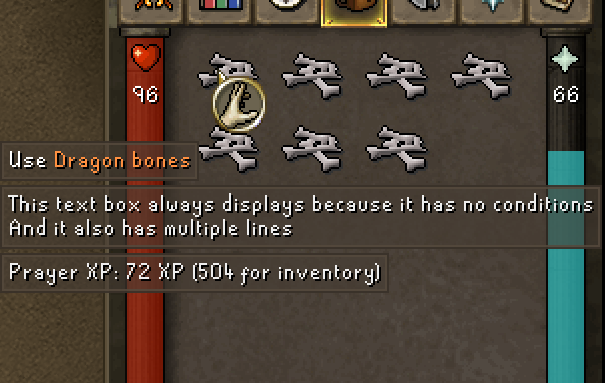
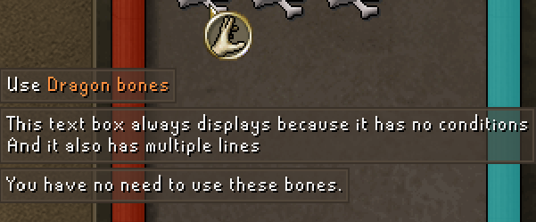

# Conditions

## Overview
> [!IMPORTANT]  
> Conditions are very useful, but only if paired with an understanding of [Functions](/docs/Functions.md) and [Variables](/docs/Variables.md).


Using expressions, you can control whether or not a hover text displays.

You can specify conditions in **two places**:
1. On a top-level hover definition in a hover file
   2. A "top-level hover definition" is the JSON object which specifies item name(s), and contains the 2D array of hover text boxes.
3. On each hover text box contained within a top-level hover definition


## Top-Level Conditions

Use top-level conditions to control whether an _entire set of hovers_ will display for an item.

Top-level conditions are specified in the `condition` field of a hover definition. This condition is evaluated when the player hovers over an item, and if it evaluates to `false`, the entire set of hovers will not display.

**Top-level conditions apply to only the hover they're defined in.** A single hover file can contain many hover definitions, each with their own top-level condition.

For example, let's look at the following hover file:

```json
{
  "is_hover_map": "absolutely",
  "hovers": [
    {
      "items": ["Dragon bones"],
      "condition": "prayer_level_real < 99 || inv_qty('Coins') >= 100000000",
      "hovers": [
        [
          "Prayer XP: 72 XP (${inv_qty('Dragon bones') * 72} for inventory)"
        ]
      ]
    }
  ]
}
```

In the above example, we create a hover which:
- Displays when hovering over Dragon bones
- Calculates and displays the amount of prayer XP from Dragon bones in the player's inventory
- Only displays if the player has not maxed prayer, OR has at least 100m coins in their inventory

Any expression which evaluates to `true` or `false` (or `1` or `0`) can be used here. For example, a valid expression is:

```
prayer_level_real < 99 || inv_qty('Coins') >= (equipment_qty('Rune arrows') * pow(inv_qty('Fire rune'), 2))
```

## Individual Hoverbox Conditions

Use hover box-level conditions to control whether a _specific hover text box_ within `hovers` will display.

Due to limitations of JSON and my own mistakes as a plugin author, hover box-level conditions are specified differently than top-level conditions.

To specify a hover box-level condition, the first entry in the hover box must begin with `?`, followed by a condition expression inside of `${}` tags.

EG, `?${prayer_level_real < 99}`

For example, let's look at the following hover file:

```json
{
  "is_hover_map": "absolutely",
  "hovers": [
    {
      "items": [
        "Dragon bones"
      ],
      "hovers": [
        [
          "This text box always displays because it has no conditions",
          "And it also has multiple lines"
        ],
        [
          "?${prayer_level_real < 99 || inv_qty('Coins') >= 100000000}",
          "Prayer XP: 72 XP (${inv_qty('Dragon bones') * 72} for inventory)"
        ],
        [
          "?${prayer_level_real == 99}",
          "You have no need to use these bones."
        ]
      ]
    }
  ]
}
```

Notice how, within `hovers`, we have _three distinct entries_:

```json
        [
          "This text box always displays because it has no conditions",
          "And it also has multiple lines"
        ]
```

```json
        [
          "?${prayer_level_real < 99 || inv_qty('Coins') >= 100000000}",
          "Prayer XP: 72 XP (${inv_qty('Dragon bones') * 72} for inventory)"
        ]
```

and

```json
        [
          "?${prayer_level_real == 99}",
          "You have no need to use these bones."
        ]
```

The second two each have a _condition expression_ as their first entry, which is not rendered as normal text but is used to determine if that box will display.

Every _following_ entry in the hover box is a normal hover text line which will display if the condition is met.


Here is what it looks like if the player hovers over dragon bones -- first without 99 prayer, second time with it.

