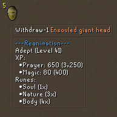
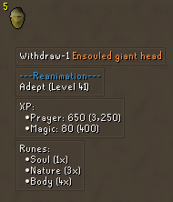

# Hover File

A Hover File is simply a JSON file with a specific structure.

For the purposes of this document, we will be working off of the [examples/ensouled_heads_no_table.json](/examples/ensouled_heads_no_table.json) file. 

Let's look at a truncated version of this file:

## Overall Structure
```json
{
  "is_hover_map": "absolutely",
  "hovers": [
    {
      "items": ["Ensouled goblin head"],
      "hovers": [
        [
          "<col=3498db>---Reanimation---</col>",
          "Basic (Level 16)",
          "XP:",
          "  \u2022Prayer: 130 (${qty * 130})",
          "  \u2022Magic: 32 (${qty * 32})",
          "Runes:",
          "  \u2022Nature (2x) (${qty * 2})",
          "  \u2022Body (4x) (${qty * 4})"
        ]
      ]
    },
    ...
  ]
}
```

Every hover file, at its JSON root, must have `is_hover_map => "absolutely"`. This is just a simple header to let the plugin know that this is really a hover file. If this isn't present, the plugin won't process the file.

Next, we have an array of `hovers`. Each entry in this array is a JSON object, representing a hover.

## Individual Hover Structure

We're looking at the following hover definition (taken from the above file) for this section:

```json
{
  "items": ["Ensouled giant head"],
  "hovers": [
    [
      "<col=3498db>---Reanimation---</col>",
      "Adept (Level 41)",
      "XP:",
      "  \u2022Prayer: 650 (${qty * 650})",
      "  \u2022Magic: 80 (${qty * 80})",
      "Runes:",
      "  \u2022Soul (1x) (${qty})",
      "  \u2022Nature (3x) (${qty * 3})",
      "  \u2022Body (4x) (${qty * 4})"
    ]
  ]
}
```

### Targeting

First, we need to specify which items this hover applies to. We have two options: `items` or `items_regex`.

`items` is an array of strings representing the names of items that this hover should apply to.

`items_regex` works the same as `items`, but it is an array of *regular expressions* instead of exact item names. If you don't understand regular expressions, just use `items`.


Note that both `items` and `items_regex` can be specified for the same hover file, and they'll both apply -- if an item name matches any entry in `items` OR in `items_regex`, the hover will display for that item.


### Hover Contents

Next, we have our `hovers` entry:

```json
"hovers": [
  [
  "<col=3498db>---Reanimation---</col>",
  "Adept (Level 41)",
  "XP:",
  "  \u2022Prayer: 650 (${qty * 650})",
  "  \u2022Magic: 80 (${qty * 80})",
  "Runes:",
  "  \u2022Soul (1x) (${qty})",
  "  \u2022Nature (3x) (${qty * 3})",
  "  \u2022Body (4x) (${qty * 4})"
  ]
]
```

(*Note: the `\u2022` is just a unicode format to display a bullet-point*)

#### 2D Array Format

`hovers` is a 2-dimensional array of JSON strings. Note that the hover text is surrounded by *two* `[[` / `]]`, not one.

The way this works is, each sub-array of JSON strings is concatenated into a single _hover box_, with each entry separated by a linebreak.


For example: the current form will produce a single hover box, with each entry on its own line:



However, we can split this up into multiple hover boxes like so:

```json
"hovers": [
  [
    "<col=3498db>---Reanimation---</col>",
    "Adept (Level 41)"
  ],
  [
    "XP:",
    "  \u2022Prayer: 650 (${qty * 650})",
    "  \u2022Magic: 80 (${qty * 80})"
  ],
  [
    "Runes:",
    "  \u2022Soul (1x)",
    "  \u2022Nature (3x)",
    "  \u2022Body (4x)"
  ]
]
```

Which will result in the following:




## Expressions, Variables, and Functions

### Quick Example
You may have noticed the following text in the above example:

`Prayer: 650 (${qty * 650})`

This is an example of an _expression_, which allows you to perform math and insert variables into your hovers.

This example will multiply the quantity of the stack you're hovering over by `650` and use that as the expression value. It will also auto-format large numbers with commas.

For example, if you were hovering over a stack of 10 items, the above hover text would result in the following final hover text:

`Prayer: 650 (6,500)`

### Deeper Dive

To use expressions, simply place a valid mathematical expression in `${}`, like so:

`${1 + 2}`

Almost any mathematical expression, with full support for parentheses, is supported. For example, the following expression is supported:

`${(15 / 6) - ((8 * 7/6) / 16)`

Specifically, the following features are supported:
- Parentheses (`(`, `)`)
- Arithmetic (`+`, `-`)
- Multiplication/Division/Modulo (`*`, `/`, `%`)
  - _Note: Modulo gives you the _remainder_ of division. EG, `5 % 3` results in `2`.
- Variables (eg, `qty` or `price`)
  - See [variables](#variables)
- Functions (eg, `floor(qty / 15)`)
  - See [functions](#functions)
- Boolean logic (`>`, `>=`, `<`, `<=`, `==`, `!=`, `||`, `&&`)
  - Right now, these don't serve much purpose: a truthful value just resolves to `1` and a false value just resolves to `2`.
    - EG, `${((1 == 1) && (2 == 2)) + (1 && 1)}` would resolve to `2`
      - `((1 == 1) && (2 == 2))` simplifies to `((1) && (1))`, which simplifes to `1`
      - `(1 && 1)` results in `1` because `&&` returns `1` if both operators are non-zero
      - Therefore, the expression simplifies to `(1) + (1)` which equals `2`
  - Eventually, I will add support for _conditionals_ on hovers, which is where these operators will be actually useful
    - EG, you could set the following condition on a hover: `qty > 50 && hunter_level < (fishing_level * 2)`
      - The hover would then only appear if the item being hovered over has a stack count greater than 50, AND the player's
  hunter level is less than twice their fishing level

Exponents, and any other operator not listed above, **are not** presently supported.

### Variables

Aside from raw numbers, you can use variables in your expressions.

EG, `${qty + (high_alch * 2)}` would output a number equal to the item stack's quantity plus twice its high-alch value.

There are a few variables that are always available for use:
- `id`
  - The numeric ID of the item in the game engine
- `qty`
  - The number of items in the stack
- `value`
  - The clientside value of the item (which is used to determine shop price, alch price, etc.)
- `high_alch`
  - The high-alch price of the item
  
Outside of these, you can define your own variables, using [Item Data Tables](#item-data-tables)

### Functions

Functions are also supported in expressions, although there are very few available right now.


- `floor(x)`
  - Rounds down whatever is passed to it
- `ceil(x)`
  - Rounds up whatever is passed to it
  
## Item Data Tables

Item Data Tables allow you to specify variables on items, which are then usable by your hover expressions.

This is a powerful feature that enables you to make much cleaner hover files, much faster.

[Click here](/docs/ItemTables.md) to learn more.